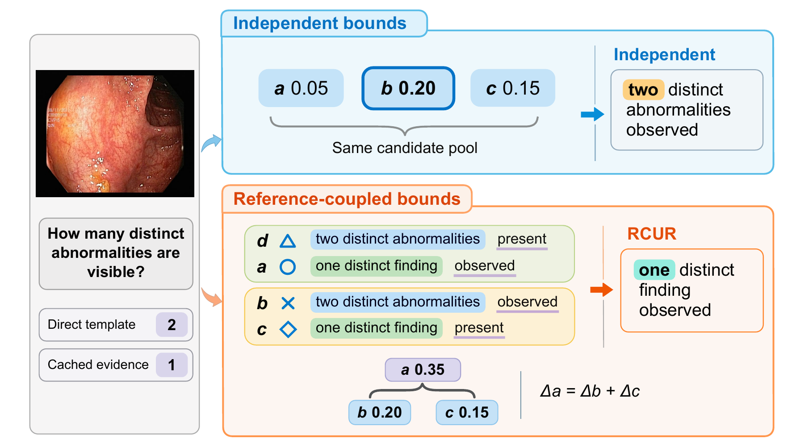
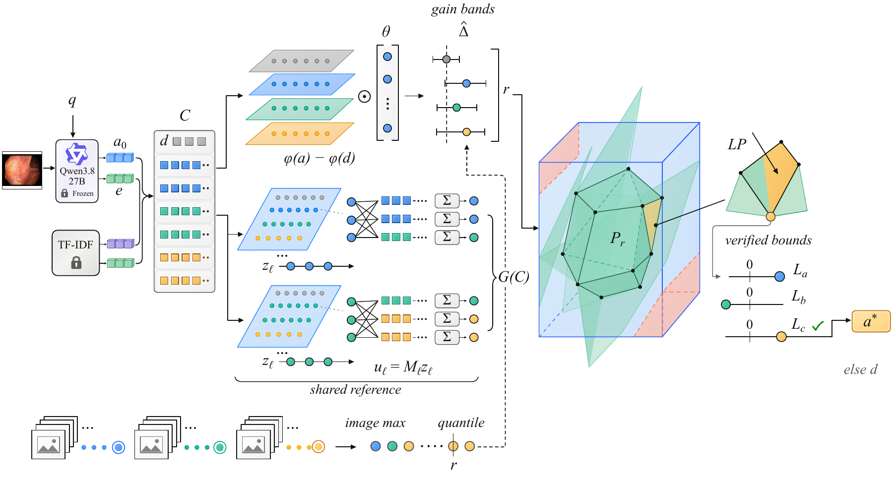
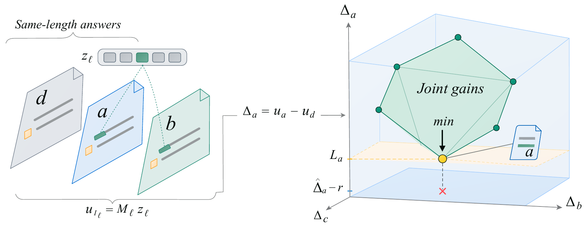
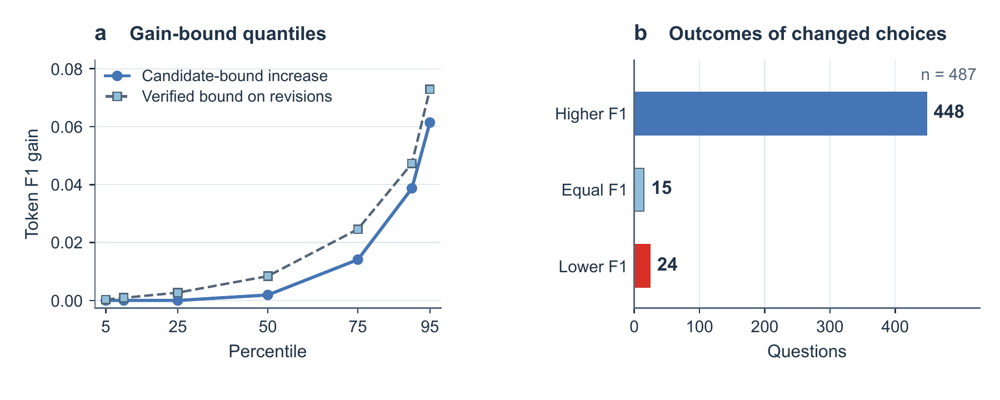
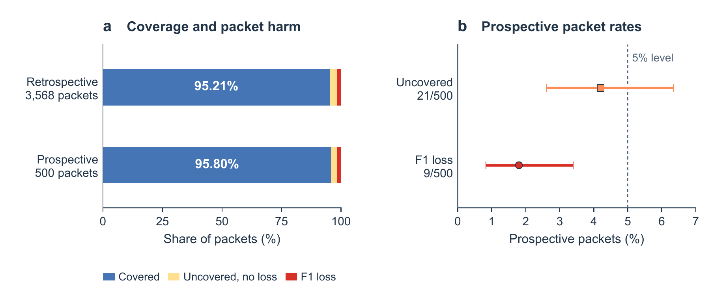
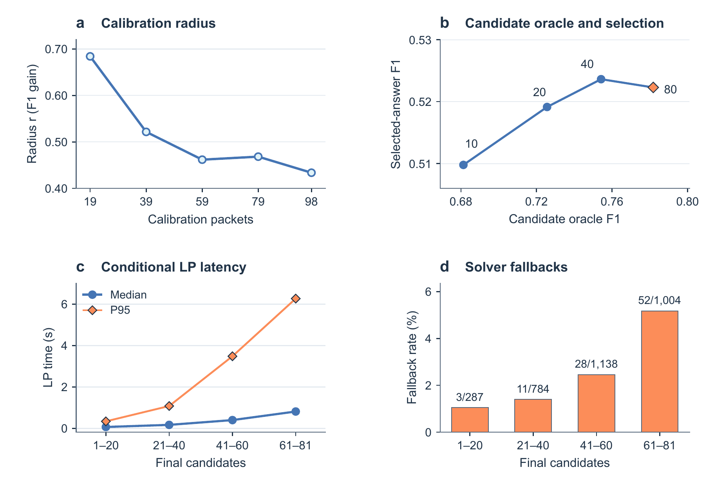

<div align="center">

# Unchosen Answers Count

### Revising Medical VQA Answers by Bounding Gains with Shared-Reference Constraints

**Reference-Coupled Utility Revision · RCUR**

Haoze Zheng · Jiong Zheng · Zeyu Li · Kaibo Qiu · Yaping Han · Yurong Qian

[](#quick-start)
[](requirements.txt)
[](#overview)
[](#experimental-data)

[Overview](#overview) · [Method](#method) · [Quick start](#quick-start) · [Results](#results) · [Data](#experimental-data) · [Code](#code-and-inputs) · [Tests](#tests) · [Citation](#citation)

</div>

## Overview

An additional answer is useful even when it is never selected. All answers to a question are evaluated against the same reference, so their token-F1 scores cannot vary independently. RCUR uses answer lengths and shared token occurrences to rule out incompatible score combinations, then checks whether an alternative has a positive worst-case gain over the direct anchor.

This repository provides the **core RCUR implementation, algorithm tests and experimental records** accompanying the manuscript. The implementation accepts candidate strings, scoring tokens and prepared features or gain predictions. Its output is the selected original answer, verified gain bounds and the decision state.

<p align="center">
  
</p>

## Method

RCUR fits a shared predictor to the token-F1 gain of each candidate over the anchor. Image-packet calibration sets a radius from the largest prediction error across every question and candidate on an image. At inference, the algorithm intersects these gain bands with constraints obtained from the candidate texts. Linear programs compute verified lower bounds; a replacement is accepted only when its bound clears the positive revision threshold.

<p align="center">
  
</p>

The decision for candidate $a$ uses

$$
\Delta_a=u_a-u_d,\qquad
L_a=\min_{u\in\mathcal P_r}(u_a-u_d).
$$

Here, $d$ is the direct anchor and $\mathcal P_r$ combines the calibrated gain bands with shared-reference constraints. Equal-length candidates reuse the same unknown token contributions through their incidence matrix. Candidates that are not output still restrict the joint feasible region.

<p align="center">
  
</p>

## Quick start

The core implementation runs on CPU with Python 3.12 and NumPy 2.3.5.

```bash
git clone https://github.com/mire403/RCUR.git
cd RCUR
python3 -m venv .venv
source .venv/bin/activate
python -m pip install -r requirements.txt
python run_rcur.py --help
python -m unittest discover -s tests -v
```

For prepared input files, the command-line workflow is:

```bash
python run_rcur.py fit --input fitting.json --lambda 0.1 --output model.json
python run_rcur.py calibrate --input calibration.json --alpha 1/20 --output radius.json
python run_rcur.py revise --input questions.json --model model.json --calibration radius.json --output answers.json
```

The input formats are described in [Code and inputs](#code-and-inputs). Fitting and calibration use image-disjoint packets. The predictor and candidate construction are frozen before calibration.

## Results

### Main Kvasir-VQA-x1 comparison

The main evaluation contains **13,488 questions in 3,568 image packets**. Revision and harm rates below use all questions as their denominator. Harm is a decrease in token F1 relative to the same direct anchor.

| Method | Mean F1 | Revision rate | Question harm |
|:---|---:|---:|---:|
| Direct anchor | 0.50467 | 0.00% | 0.00% |
| Independent box | 0.51532 | 6.29% | 0.62% |
| **RCUR** | **0.52363** | **9.15%** | **0.56%** |
| Nominal argmax | 0.52488 | 30.69% | 10.54% |
| Shallow GBDT | 0.52864 | 30.82% | 9.66% |
| Nominal, 9% target | 0.51799 | 8.95% | 1.34% |
| GBDT, 9% target | 0.52135 | 9.33% | 0.93% |
| MMed-RAG adaptation | 0.53254 | 31.48% | 8.80% |
| LENS adaptation | 0.53704 | 30.95% | 7.58% |

With the candidates, predictor and radius fixed, coupling changes **487 selections** relative to independent-box selection: 448 improve F1, 24 reduce it and 15 tie. The mean gain is **0.00831**, with a 95% image-cluster interval of **[0.00748, 0.00914]**. At a similar revision rate, RCUR reduces harmful revisions from 126 to 76 compared with the 9%-target GBDT selector.

<p align="center">
  
</p>

### Fresh packets and factual assessment

The fresh-packet evaluation uses **public-data resampling**, with 98 new calibration packets and 500 evaluation packets containing 1,891 questions. Joint coverage is 479/500 and packet harm is 9/500. Mean F1 rises from 0.50485 to 0.52003.

On the 400-question factual assessment, RCUR has 296 correct answers (74.00%), compared with 271 (67.75%) for the anchor. The released factual tables include unresolved outcomes, category counts, label transitions and rater agreement.

<p align="center">
  
</p>

### Budgets and target-domain adaptation

The results also cover retrieval and candidate budgets, field and prompt ablations, calibration sample size, solver latency and SLAKE English adaptation. With target-domain fitting and calibration, SLAKE F1 rises from 0.77860 to 0.78334. The default Kvasir pipeline takes 5.0714 seconds per question, including its two generation calls; LP processing and verification account for 0.2140 seconds averaged over all questions.

<p align="center">
  
</p>

## Experimental data

| File | Contents |
|:---|:---|
| [`data/kvasir_main.csv.gz`](data/kvasir_main.csv.gz) | 13,488 aligned question records for nine methods, token counts, overlap counts, decision flags and packet indices |
| [`data/kvasir_resampled.csv.gz`](data/kvasir_resampled.csv.gz) | 1,891 fresh-packet question records for anchor and RCUR, token counts and coverage/revision flags |
| [`data/coefficients.csv`](data/coefficients.csv) | The 83 reported feature coefficients and their ordered feature keys |
| [`data/figure_data.json`](data/figure_data.json) | Aggregate numerical data for Figures 4–6 |
| [`results/main_methods.csv`](results/main_methods.csv) | Main method summaries at the stored numerical precision |
| [`results/index.csv`](results/index.csv) | Mapping of all 25 manuscript tables to their CSV files, including protocol and method tables |
| [`results/tables/`](results/tables/) | Main and appendix tables covering comparisons, ablations, factual assessment, runtime and the earlier set-F1 study |

CSV files use UTF-8; question-level records are gzip-compressed. `question_index` and `packet_index` are internal integer identifiers. Questions sharing a packet index belong to the same image packet. A method's token F1 is `2 * overlap / (prediction_length + reference_length)`. Rates in `main_methods.csv` are fractions; columns explicitly marked `%` in the manuscript tables are percentages. The index labels earlier set-F1 results by their scoring protocol.

The raw image datasets are available from their original providers: [Kvasir-VQA-x1](https://datasets.simula.no/kvasir-vqa-x1/) and [SLAKE](https://www.med-vqa.com/slake/).

For example, the following reads the released main records and calculates each method's mean F1:

```python
import csv
import gzip

with gzip.open("data/kvasir_main.csv.gz", "rt", encoding="utf-8", newline="") as stream:
    rows = list(csv.DictReader(stream))

for method in ("Anchor", "Box", "RCUR", "Nominal", "GBDT"):
    mean_f1 = sum(float(row[f"{method}_f1"]) for row in rows) / len(rows)
    print(f"{method:8s} {mean_f1:.5f}")
```

## Project layout

```text
RCUR/
├── README.md
├── requirements.txt
├── run_rcur.py
├── experiment_code/
│   ├── rcur_core.py
│   └── rational_lp.py
├── calibration/
│   └── exact_calibration.py
├── data/
│   ├── kvasir_main.csv.gz
│   ├── kvasir_resampled.csv.gz
│   ├── coefficients.csv
│   └── figure_data.json
├── results/
│   ├── index.csv
│   ├── main_methods.csv
│   └── tables/
├── tests/
│   ├── test_core.py
│   └── test_calibration.py
└── figure/
    └── Figure1.png … Figure6.png
```

## Code and inputs

| Component | Operations |
|:---|:---|
| `experiment_code/rcur_core.py` | Image-weighted ridge fitting, gain prediction, packet calibration, incidence and distance constraints, bound verification and anchored revision |
| `experiment_code/rational_lp.py` | Two-phase rational simplex and the shared pivot budget |
| `calibration/exact_calibration.py` | Packet calibration directly from integer token counts |
| `run_rcur.py` | JSON interfaces for fitting, calibration and batch revision |

Use `rcur_core.calibrate_radius` for the calibration protocol reported in the paper. `calibration/exact_calibration.py` computes packet radii from integer token counts.

**Fitting.** `fitting.json` contains `packets`, each with a `questions` list. A question supplies `features` (a `K × 83` array normalized by `sqrt(83)`), `anchor_index` (zero-based) and `gains` (one reference F1 gain per candidate). The command writes the fitted coefficients and fit status.

**Calibration.** `calibration.json` uses the same packet/question organization. Each question supplies matching `gains` and `predictions` arrays. All questions and candidates for an image contribute to its maximum residual. The output preserves the floating-point radius and its hexadecimal representation.

**Revision.** `questions.json` contains a `questions` list. Each question supplies `question_id`, `anchor_index`, `features` and a `candidates` list. A candidate has `text` (the original answer), `identity` (its unique normalized identity) and `tokens` (the scoring-token list, retaining repetitions). To use already computed gains, omit `--model` and supply `predictions` instead of `features`.

The output contains `selected_index`, `answer`, `revised`, `reason`, `pivots` and verified `bounds`. The default threshold is `1e-8`, with a cumulative budget of 50,000 simplex pivots per question. The anchor is returned when the verified decision conditions are not met.

## Tests

```bash
python -m unittest discover -s tests -v
```

Tests check shared-reference score relations, incidence-envelope membership, exact LP solutions against independent vertex enumeration, image-balanced fitting, finite-sample calibration ranks, dual-bound direction, tie rules, thresholding and anchor returns. Count-based calibration tests also cover empty answers, malformed inputs, floating-point enclosure and exact JSON round trips.

## Citation

```bibtex
@misc{zheng2026unchosen,
  title  = {Unchosen Answers Count: Revising Medical VQA Answers by Bounding Gains with Shared-Reference Constraints},
  author = {Zheng, Haoze and Zheng, Jiong and Li, Zeyu and Qiu, Kaibo and Han, Yaping and Qian, Yurong},
  year   = {2026},
  url    = {https://github.com/mire403/RCUR}
}
```

For questions about the method or experimental records, please use [GitHub Issues](https://github.com/mire403/RCUR/issues).
